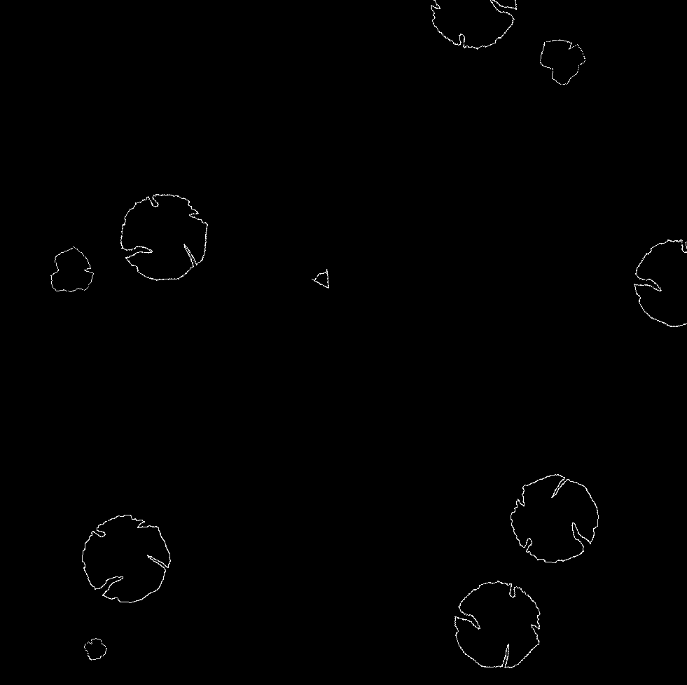

# Kuiper

Kuiper is a small game based on the classic *Asteroid*. This project was made mainly to learn more about C++.

## Build

This project requires Cmake 3.25.1 and SFML 3.1.0 to be built.

In a terminal, go to the base folder and run the `build.sh` script. After the compilation, the executable `Kuiper` should appear in this folder.

## Run

To run, the `assets` sub-directory should be in the same directory as the executable.

### Controls
- W (QWERTY) / Z (AZERTY) to go forward.
- A (QWERTY) / Q (AZERTY) and D to rotate the ship.
- SPACE to shoot a laser.
- ESCAPE to open the pause menu.
- F3 to enable the debug view.

There is currently no automatic restart mechanism if you die or if all asteroids are destroyed, but you can open the pause menu and click "retry".